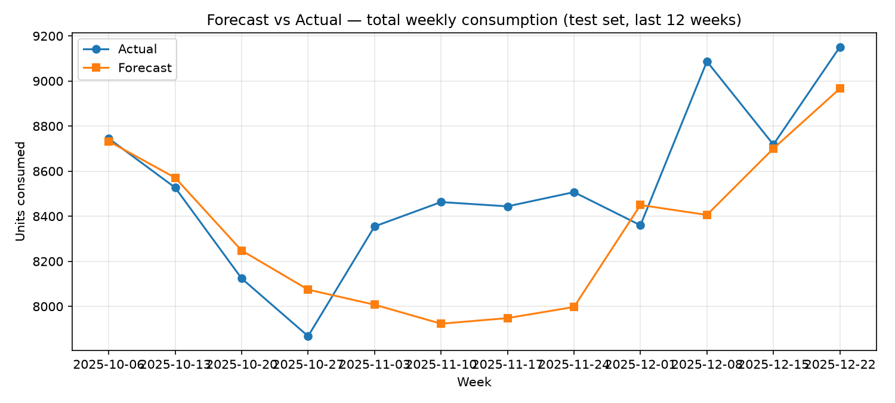
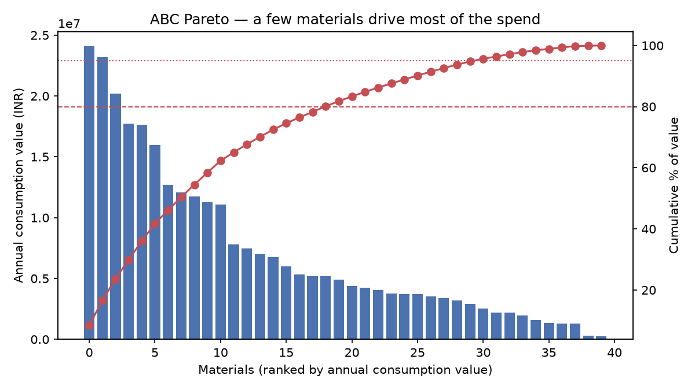

# SAP Inventory & Demand Forecasting

> **All data in this project is synthetic.** It mimics the shape of SAP MM
> tables (materials, plants, weekly consumption, purchase orders) so the
> whole pipeline runs end-to-end without any real employer data or ERP access.

## The problem

In a supply-chain / SAP MM role, the expensive mistakes are simple ones:
ordering too late (production stops, a stockout) or ordering too much
(cash locked up in slow-moving stock). Planners usually work from gut feel
and last month's numbers. This project turns 24 months of weekly consumption
into a **one-week-ahead demand forecast** plus **safety stock, reorder points
and a stockout-risk flag for every material × plant** — the exact inputs a
buyer needs to raise a purchase requisition at the right time, in the right
quantity.

**Business impact, in plain language:**

- **Fewer stockouts** — 50 of 120 material-plant combinations are flagged
  MEDIUM/HIGH risk right now, with a recommended order quantity for each.
- **Less cash in stock** — ABC analysis shows 18 of 40 materials drive
  ~80% of annual consumption value, so tight control belongs on those A-items
  (e.g. `MAT-SP-003`, ~₹2.41 Cr/year), not spread evenly.
- **A defensible number for the forecast** — the model is evaluated on the
  last 12 weeks it has never seen, not on data it trained on.

## Architecture

```
synthetic SAP-like CSVs (src/generate_data.py)
        │
        ▼
SQLite demo DB  ── data/inventory.db   (schema.sql is the MySQL DDL)
  tables: materials, plants, consumption_history, purchase_orders,
          inventory_snapshot, forecasts, reorder_recommendations
  views:  v_stock_by_plant, v_abc_analysis, v_consumption_value
        │
        ▼
features: lag 1/4/12 wks, rolling mean 4/12 wks, month, week-of-year,
          plant + material one-hots        (src/train.py)
        │
        ▼
RandomForestRegressor (n_estimators=200) ──► models/demand_forecast.joblib
        │                                     results/metrics.json
        ▼
safety stock + reorder point + ABC class ──► reorder_recommendations
        │
        ▼
Streamlit dashboard (app.py) — KPIs, forecast vs actual, stock by plant,
ABC Pareto, and a table of actionable reorder recommendations
```

## Tech stack

| Layer | Tools |
|---|---|
| Language | Python 3.10+ (tested on 3.12) |
| Data | pandas, numpy |
| ML | scikit-learn (RandomForestRegressor), joblib |
| Database | SQLite for the runnable demo (`sqlite3` stdlib); MySQL DDL in `schema.sql`, analytical views in `sql/` |
| Dashboard | Streamlit |
| Charts | matplotlib |
| Tests | pytest |

## Dataset

Synthetic, generated by `src/generate_data.py` (seeded, reproducible):

- **40 materials** across 4 families — Raw Material, Spare Part, Packaging,
  Consumable — each with a unit cost, lead time (1–8 weeks), base demand,
  trend and seasonality phase.
- **3 plants** — Delhi (P100), Noida (P200), Gurugram (P300).
- **24 months of weekly consumption** — 104 weeks × 40 materials × 3 plants
  = **12,480 rows**, with annual seasonality (festive-quarter peak), trend
  and noise.
- **1,191 purchase orders** and a **120-row inventory snapshot**
  (one row per material × plant, 0.5–12 weeks of cover, some SKUs
  deliberately low to exercise the risk flags).

## How to run

```bash
python3 -m venv .venv
source .venv/bin/activate
pip install -r requirements.txt

python src/generate_data.py   # creates data/*.csv
python src/load_to_db.py      # creates data/inventory.db + views
python src/train.py           # trains model, writes results/metrics.json,
                              # docs/*.png, forecasts + reorder rows to the DB
streamlit run app.py          # dashboard at http://localhost:8501
```

Run the tests with:

```bash
python -m pytest tests/test_smoke.py -v
```

## Model results

Time-based split: train on weeks 1–92, test on the **last 12 weeks**
(1,440 rows the model never saw during training).

| Metric | Value |
|---|---|
| Model | RandomForestRegressor (n_estimators=200, max_depth=12) |
| Train rows | 9,600 |
| Test rows | 1,440 (last 12 weeks) |
| **MAE** | **11.85 units** |
| **RMSE** | **20.37 units** |
| **MAPE** | **17.57%** |
| **R²** | **0.911** |

Full numbers live in [`results/metrics.json`](results/metrics.json).

**Planning outputs from the same run:**

| Output | Value |
|---|---|
| Total inventory value | ₹1,43,60,605 |
| SKUs at stockout risk (MEDIUM/HIGH) | 50 / 120 (25 HIGH, 25 MEDIUM) |
| ABC classes (materials) | A: 18 · B: 12 · C: 10 |

## SQL highlights

- **`schema.sql`** — full MySQL 8.0 DDL for all 7 tables, with foreign keys
  and indexes (the SQLite demo applies the equivalent DDL).
- **`sql/v_stock_by_plant.sql`** — inventory value, SKU count and
  zero-stock SKUs per plant.
- **`sql/v_abc_analysis.sql`** — ABC classification by annual consumption
  value using a window function (A = top 80% of value).
- **`sql/v_consumption_value.sql`** — weekly consumption value with a
  4-week rolling average per material-plant.

Example — stock position per plant:

```sql
SELECT plant_name, sku_count, inventory_value_inr, zero_stock_skus
FROM v_stock_by_plant;
-- Delhi Plant    40  ₹28,19,598   0
-- Noida Plant    40  ₹19,29,247   0
-- Gurugram Plant 40  ₹14,50,330   0
```

Safety stock and reorder point (per material-plant, in `src/train.py`):

```
safety_stock  = z × σ(weekly demand) × √lead_time_weeks
reorder_point = avg_weekly_demand × lead_time_weeks + safety_stock
stockout risk = HIGH if on_hand ≤ 50% of reorder point,
                MEDIUM if on_hand ≤ reorder point, else LOW
```

## Screenshots




## Future improvements

- Replace the single RandomForest with a per-material-family model, or add
  a seasonal-naive baseline for comparison.
- Add a proper forecast horizon (4–8 weeks ahead) instead of one week.
- Point `load_to_db.py` at a real MySQL instance (the DDL is already
  MySQL-ready) and schedule weekly retraining.
- Add vendor lead-time reliability (late deliveries) into the safety-stock
  formula.
- Add a service-level target per ABC class (e.g. 98% for A-items) instead of
  one safety factor per material.

## Author

**Rishu Yadav** — M.Tech CSE (AI), Netaji Subhas University of Technology.
SAP MM end-user at Compass (7 months, supply chain). Skills: Python, MySQL.
Building towards SAP ABAP / Python / AI / Data roles in Delhi NCR.
